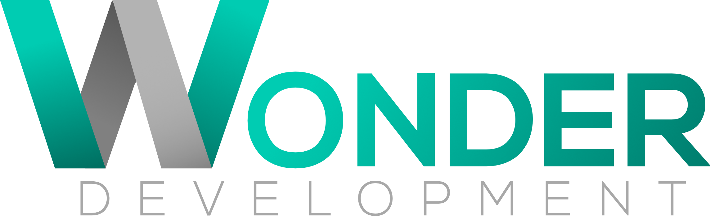

  

# adhi1284

Independent web developer and project builder creating responsive websites, web applications, and multiplayer browser experiences. My work connects interface design, browser graphics, and practical backend development. My independent work includes 20+ projects for clients.

  <a href="https://wondertoolbox.com/Profile/">Portfolio</a> ·
  <a href="https://wondertoolbox.com/">Wonder Development</a> ·
  <a href="https://keralaegg.online/">Kerala Egg</a> ·
  <a href="https://wondertoolbox.com/#contact">Discuss a project</a>

## What I build

- Responsive business websites and e-commerce interfaces.
- Web applications with attention to UI/UX and usability.
- Multiplayer browser games and interactive 3D experiences.

## Technology

  
  
  
  
  
  
  

## Selected projects

| Project | Overview | Explore |
| :--- | :--- | :--- |
| **Kerala Egg** | Multiplayer 3D browser game set in a Kerala-inspired village. | [Game website](https://keralaegg.online/) |
| **Wonder Development / Wonder Toolbox** | Website development services for business websites, e-commerce, and web applications. | [Website](https://wondertoolbox.com/) |
| **WonderAuth** | Authentication web application for developers. | [Website](https://wonderauth.online/) |
| **WonderScreen** | AirPlay and screen casting software for Windows. | [Website](https://wonderscreen.online/) |

[Browse my public repositories →](https://github.com/adhi1284?tab=repositories)

## GitHub activity

  
  
  

Explore my [contribution activity](https://github.com/adhi1284#js-contribution-activity-description). GitHub's native contribution graph appears below this README on my profile; these badges show live public metrics.

## Let's build

For website development or a custom web project, [contact Wonder Development](https://wondertoolbox.com/#contact).
